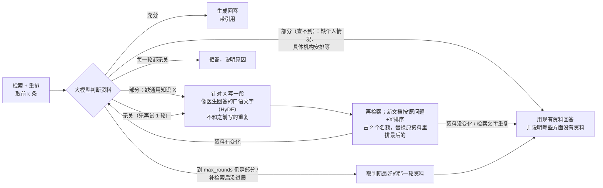

# 中文 RAG 检索问答与评测：BM25 + BGE + Faiss + 重排 + 大模型补标

一个**可复现、可量化**的中文 RAG（检索增强生成）项目，包括两部分：

1. **问答系统**：jieba + BM25 关键词召回、BGE 向量召回（Faiss 索引）、RRF / 加权融合、交叉编码器重排，最后让大模型**带引用**地回答，资料只够答一部分时说明缺什么，完全无关时**拒答**。
   可选的 **agent 模式**（`answer_with_check`）：回答前先让大模型判断资料够不够；缺的是别的医生回答里可能有的知识才补检索（新文档保留名额），缺的是个人情况这类查不到的就直接回答并说明缺什么，只有资料完全无关才拒答。
2. **评测工具链**：一条命令跑完消融实验，自动做失败分类、配对显著性检验、融合调参；针对公开数据集**标注不完整**的问题，提供"候选池 + 大模型补标 + 人工盲评"的补标评测流程。


agent 模式（`ask.py --agent`）在重排和生成之间加了一个"检查—补检索"的循环：



---

## 一、这个项目能做什么

| 你想做的事 | 用什么 |
| --- | --- |
| 在自己的文档上搭一个能回答问题、带出处的问答系统 | `prepare_data.py` → `build_index.py` → `ask.py` |
| 比较 BM25 / 向量 / 混合 / 重排哪种检索方式更好，并知道差距是不是真的 | `evaluate.py`（消融表 + 显著性检验） |
| 找出检索失败的原因：没召回、融合弄丢了、还是重排排错了 | `evaluate.py` 的失败分类 + `_failures.jsonl` |
| 调融合方式和权重，而不污染测试集 | `tune_fusion.py`（只在 dev 上调） |
| 比较两次实验（比如换了嵌入模型）的差距是否显著 | `compare_runs.py` |
| 数据集标注不全、指标看起来不可信时，补标后重新评估 | `relabel.py judge` + `relabel.py agree` |
| 让系统先判断资料够不够、不够就再查、查不到就拒答 | `ask.py --agent`（`rag/advanced/query_rewrite.py`） |
| 评估 agent 比"检索一次直接回答"好在哪、多花多少 | `eval_agent.py`（API 不可用时用 `offline_agent_eval.py` 离线跑） |
| 小模型分流：闲聊 / 知识库外不检索、简单题小模型答，看省多少、质量掉不掉 | `ask.py --router`、`eval_router.py` |
| 长文档"检索按小块、给模型完整小节"（父子分块） | `eval_hierarchical.py` |
| 用 train 划分微调 BGE | `finetune_embedder.py` |

---

## 二、实验结论（CMedQA，dev 500 条）

数据集：`mteb/CmedqaRetrieval`（中文医疗问答，约 10 万篇文档、4000 条查询，按 2499 / 500 / 1000 划分为 train / dev / test）。嵌入模型 `bge-base-zh-v1.5`，重排模型 `bge-reranker-v2-m3`（top_n=50）。指标 ×100。

> 以下都是 dev 上的结果，用来做方法选择和分析；test 上的最终报告待用定好的配置跑一次后补上。

### 1. 检索消融（原始标注）

| 方法 | R@10 | R@100 | MRR@10 | nDCG@10 | ms/q |
| --- | --- | --- | --- | --- | --- |
| BM25 (jieba) | 16.3 | 34.8 | 15.2 | 13.2 | 1.9 |
| Dense (BGE + Faiss) | 51.8 | 80.4 | 42.5 | 41.0 | 1.4 |
| Hybrid · RRF（调参后） | 51.5 | 80.4 | 42.8 | 41.1 | 3.7 |
| Dense + Rerank | 50.9 | 80.4 | 41.0 | 39.3 | 173.9 |
| Hybrid + Rerank | 50.7 | 80.4 | 40.7 | 39.1 | 184.3 |

### 2. 发现并修复融合缺陷

等权 RRF（k=60）会被很弱的 BM25 拖累：BM25 召回的无关文档占掉一半融合名额，向量召回排在后面的正确答案被挤出前 100。用 `tune_fusion.py` 在 dev 上比较 17 组设置（16 组融合参数 + 单用 dense）：

| 融合方式 | nDCG@10 | R@100 | 融合丢失率 | 相对 Dense |
| --- | --- | --- | --- | --- |
| 原配置：等权 RRF，k=60 | 30.8 | 75.1 | 5.6% | -10.19（显著） |
| 调参后：RRF k=10，BM25 权重 0.1 | 41.1 | 80.4 | 0.6% | +0.03（不显著） |

结论：修复后混合检索与单用向量持平；**BM25 在这个数据集上没有显著增益**（口语提问和医生术语字面对不上）。

### 3. 标注不完整：补标后结论反转

CMedQA 的"正确答案"是原帖下医生的回复，平均每题只有 1.86 个；语料里其他同样能回答的回答一律算错。原始标注下重排看起来**变差**，抽查失败案例发现，重排排上来的往往比标注答案更贴题。

于是对 6 种方法前 10 名的并集（11251 对未标注 + 100 对原正例抽查）做补标：主评审 `deepseek-flash` 打 0/1/2 分（约 30 元），它因思考超长没给出分数的 283 对由备用评审补判；再抽 100 对人工盲评。

| 方法 | 原始 nDCG@10 | 补标·严格(2 分算相关) | 补标·宽松(≥1 分算相关) |
| --- | --- | --- | --- |
| BM25 | 13.2 | 15.7 | 43.1 |
| Dense | 41.0 | 51.2 | 87.9 |
| Hybrid · RRF | 41.1 | 51.3 | 87.9 |
| Dense + Rerank | 39.3 | 51.9 | 90.3 |
| Hybrid + Rerank | 39.1 | 51.5 | 90.2 |

**Dense + Rerank 相对 Dense（nDCG@10，配对检验）：**

| 标注 | 差值 | 显著性 | 胜 / 负 |
| --- | --- | --- | --- |
| 原始 | -1.72 | 不显著（Hybrid+Rerank -1.95，显著变差） | 95 / 131 |
| 补标·严格 | +0.60 | 不显著 | 205 / 189 |
| 补标·宽松 | +2.33 | 显著（p<0.001） | 171 / 112 |

- **原始标注严重低估检索效果**：Dense 的 Hit@10 从 62% 升到 85%（严格），P@10 从 9% 升到 27%。
- **重排"变差"是标注不全造成的假象**：补标后重排不劣于 Dense，宽松口径下显著提升约 2.3 点。
- **人工盲评**（99 对）：与主评审的一致率，三档 kappa 0.49、严格口径 0.57、宽松口径 0.67。按人工标准换算，真实相关比例落在主评审"严格"和"宽松"两个口径之间，所以结论以两个口径都成立为准。
- **敏感性**：去掉备用评审补判的 283 对后，各方法绝对分数下降 0.4–2.4 点，相对结论不变（重排严格口径 +0.74）。
- **局限**：补标衡量的是"相关性"不是"正确性"（会出现切题但医学上说错的回答）；大模型评审之间一致性（kappa 0.80）高于人与模型（0.49），说明大模型评审有共同偏好，不能代替人工检验。

详细数据见 `results/relabel/`：补标报告 `*_relabel_*.md`、一致率 `*_agreement.md`、备用评审说明 `cmedqa_judgments_fallback_README.md`。

### 4. agent（answer_with_check）：迭代 5 版，结论稳定

agent = 回答前让大模型判断资料够不够，不够就补检索，资料无关就拒答。和"检索一次直接回答"（baseline）在同一批问题上配对比较：

| 版本 | 写回答 / 判断的大模型 | 可回答：helpful（baseline → agent） | 明显知识库外：拒答率 | 屏蔽相关文档：helpful | 主要问题 |
| --- | --- | --- | --- | --- | --- |
| v1（20 题试跑） | DeepSeek | 1.55 → **0.80**（显著变差） | — | — | 判断太严、术语改写、不足就硬拒答 |
| v2（380 题） | DeepSeek | 1.72 → 1.70 | 82% → **94%**（显著） | 1.26 → 1.32 | 补检索的新文档挤不进资料，补了等于没补 |
| v3（380 题） | DeepSeek | 1.72 → 1.74 | 82% → 86% | 1.26 → 1.38（拒答 22% → **12%**，显著） | 新增的"部分（查不到）"把"无关"挤掉，拒答把关失效 |
| v3.1（230 题） | Claude（离线代跑） | 1.69 → 1.67 | 84% → **100%**（显著） | 1.32 → 1.36 | 补检索后资料变差、最后一轮判"无关"被硬拒答 |
| v3.2（230 题，缓存重放） | Claude（离线代跑） | 1.69 → 1.70 | 84% → **100%**（显著） | 1.32 → 1.36 | — |
| **v3.2 · test 留出集（280 题）** | Claude（离线代跑） | **1.69 → 1.72**（+0.03，不显著） | **76% → 98%**（+22，p=0.002） | —（test 没有补标数据） | 定版配置，只跑一次 |

- **在能回答的问题上，agent 不提升回答质量**：v2 起每一版都和 baseline 持平（v2 的 200 题置信区间 −0.08 ~ +0.04）。原因是用户缺的大多是知识库里本来就没有的个人化细节，补检索找不到。
- **补检索只在"知识库更深处确实有相关文档"时有用**：屏蔽相关文档组里，v3 把拒答率显著降低了 10 个百分点。
- **agent 真正的价值是"无关就拒答"这道关**：能拦下"把别处的作息当成你家附近的""把 2020 年的发布会当成最新一期"这类误用。
  这道关实际挡住了多少危害，取决于写回答的模型本身有多谨慎：DeepSeek 写回答时会直接误用，把关挡下的是真错误；
  换成 Claude 后拒答率同样显著上升（+16 个百分点），但被挡下的 8 题里 baseline 原本就写明了"资料只有某地 / 往年的内容，仅供参考"，
  把关只是把"带说明的参考回答"变成了直接拒答，挡下的实际危害小得多。
- **判断步骤开思考没有收益**：helpful 差别在重跑噪声范围内，耗时约 2 倍。
- **评审维度有盲区**：所有版本的"无依据回答率"几乎都是 0。评审只检查结论能不能在资料里找到，查不出"资料不适用于用户的情况"。
- 迭代过程、每版的诊断和改法见"四、使用说明 → 8. agent 评测 → 迭代记录"。

**test 留出集上的最终结果**（定版 v3.2，配置不再改动；可回答 200 题来自 test 划分，知识库外的两组是新写的、迭代时没见过的问题）：

| 问题组 | 拒答率 baseline / agent | helpful baseline / agent | 无依据回答率 baseline / agent | agent 平均大模型调用 |
| --- | --- | --- | --- | --- |
| 可回答（200） | 2.0% / 4.5% | 1.69 / 1.72 | 1.5% / 1.0% | 2.7 |
| 知识库外·明显（50） | 76% / **98%** | 0.24 / 0.02 | 2.0% / 0% | 3.0 |
| 看似可答的知识库外（30） | 97% / 93% | 0.03 / 0.07 | 0 / 0 | 3.3 |

- dev 上的结论在 test 上复现了：可回答问题上持平（helpful +0.03，95% CI −0.03 ~ +0.07），拒答把关显著（+22 个百分点，p=0.002）。
- 补检索：可回答组 24.5% 的题触发，其中 41% 判断变好，这些题上 helpful 比 baseline 高 0.10，但整体仍不显著。
- 被把关挡下的 11 道知识库外问题里，baseline 的回答大多已经写明"资料没有你所在城市 / 今天的信息，只能给一般参考"，
  只有 1 题是真正的误用（把资料里的旧新闻当成"最近批准的新药"）；同时也挡掉了一些有用的一般信息（如医保卡余额的查询方式）。
- 可回答组 agent 多拒 5 题：2 题判"无关"（问"哪家医院 / 哪位专家好"，以及资料里没有胎儿 B 超数值对应关系的问题），3 题是评审把"资料只能答一部分"的回答算成了拒答。
- 新写的"看似可答"组没区分度：新药名在语料里一个都搜不到，检索拿回的资料完全不沾边，两个系统都 95% 左右拒答 —— 这组题比 dev 那组"更像知识库外"，难度没设计好。
- 结果文件：`results/agent/test_v3_2/`（`report.md`、`records.jsonl`，以及全部提示词和回答的缓存，可以复查每一条）。

> 注意：v1~v3 是用 DeepSeek 在线跑的，v3.1 / v3.2 和 test 因为 API 额度用完，判断、写回答和评审都由 Claude 离线代跑（`offline_agent_eval.py`），
> 评审由独立子任务盲评（看不到系统名、顺序打乱），但仍是同一类模型给自己的回答打分，可能偏宽。两组之间换了大模型，只能比较各自批次内 baseline 和 agent 的差别，不能直接比绝对数字。

---

## 三、快速开始

### 1. 安装（Python 3.10+，建议 NVIDIA GPU）

```bash
conda create -n rag python=3.11 -y && conda activate rag
# 先装和你 CUDA 匹配的 PyTorch，以 https://pytorch.org/get-started/locally/ 生成的命令为准，例如：
pip install torch --index-url https://download.pytorch.org/whl/cu128
pip install -r requirements.txt
```

国内下载模型和数据集，先设置镜像：

```bash
export HF_ENDPOINT=https://hf-mirror.com           # Linux / macOS / Git Bash
$env:HF_ENDPOINT = "https://hf-mirror.com"         # Windows PowerShell
```

大模型 API key 写进项目根目录的 `.env`（参考 `.env.example`，不会进 git）：

```
LLM_API_KEY=你的key
```

### 2. 五分钟跑通 demo

`data/demo` 是 30 段虚构的《云栖大学学生手册》和 18 个问题，只用来确认环境没问题（语料太小，指标没有参考意义）。

```bash
python scripts/build_index.py --config configs/demo.yaml
python scripts/evaluate.py   --config configs/demo.yaml
python scripts/ask.py        --config configs/demo.yaml -q "宿舍里能用电热毯吗"
```

---

## 四、使用说明

所有脚本默认读 `configs/default.yaml`；命令行用 `--set 键=值` 临时覆盖任意配置项（可重复）。配置和命令里的相对路径一律相对项目根目录，在哪个目录下运行（包括 PyCharm）结果都一样。

### 1. 准备数据

**公开数据集**（MTEB 格式）：

```bash
python scripts/prepare_data.py --hf mteb/CmedqaRetrieval --out data/cmedqa   # 下载并划分 train/dev/test
```

**自己的文档**：

```bash
python scripts/prepare_data.py --docs-dir my_docs --out data/mydomain --chunk-size 400 --overlap 80
```

然后写 `queries.jsonl` 和 `qrels.tsv`（格式见 `rag/data.py` 开头）：可以让大模型给每个文本块出 1–3 个问题，再人工核对至少 200 条。最后生成固定的划分：

```bash
python scripts/prepare_data.py --make-splits data/mydomain --n-test 200 --n-dev 50
```

复制 `configs/default.yaml`，把 `data_dir` / `index_dir` 改成新目录即可。没有 `splits.json` 时评测会直接报错，避免把 test 查询混进调参。

### 2. 建索引

```bash
python scripts/build_index.py                                  # BM25 + 向量 + Faiss
python scripts/build_index.py --only dense --set embedder.model=BAAI/bge-large-zh-v1.5   # 换嵌入模型
python scripts/build_index.py --only dense --set faiss.index_type=hnsw                   # 换 Faiss 索引（复用已算好的向量）
```

改了影响索引的参数（嵌入模型、max_seq_length、jieba 模式、词典、停用词、k1/b、Faiss 参数）后，要带同样的 `--set` 重建；不同嵌入模型的索引放在不同目录，互不覆盖。

### 3. 问答

```bash
python scripts/ask.py                       # 交互式，回车退出
python scripts/ask.py -q "宝宝夜里咳嗽怎么办"
```

会依次显示 BM25、向量、重排后各自的前 3 名，再显示大模型的回答和各阶段耗时。没有配置 API key 时只显示检索结果。

agent 模式：

```bash
python scripts/ask.py --agent -q "怀孕26周糖耐量空腹5.14、一小时10.73，算妊娠糖尿病吗"
```

逐轮显示：用了什么查询、拿到哪几条资料、大模型判断"充分 / 部分：缺什么 / 部分（查不到）/ 无关：原因"、补检索用的文本、新放进资料的文档；
最后是循环停止原因、回答（或拒答理由）、大模型调用次数、token 和耗时。
相关配置在 `agent:` 段（`max_rounds` 最多额外检索几轮，`refine` 补检索的写法，`merge` / `new_slots` 新文档怎么并进资料，
`max_irrelevant_retries` 判为无关时先再试几轮，`thinking` 判断步骤是否开思考）；写回答是否开思考看 `generation.thinking`。

大模型用任意 OpenAI 兼容接口（DeepSeek、通义、硅基流动、本地 Ollama / vLLM），在 `generation.base_url` / `generation.model` 里改。本地模型示例：`ollama pull qwen3:8b`，再加 `--set generation.base_url=http://localhost:11434/v1 --set generation.model=qwen3:8b`。

### 4. 评测

```bash
python scripts/evaluate.py --split dev                 # 调参、分析都在 dev 上
python scripts/evaluate.py --split dev --modes dense,dense_rerank
python scripts/evaluate.py --latency 100               # 顺便测逐条查询的 P50/P95 延迟
```

每次评测在 `results/` 下生成：

| 文件 | 内容 |
| --- | --- |
| `<名字>.md` | 消融表、相对 dense 的显著性检验、融合丢失率、失败分类、完整配置（含实际用的划分） |
| `<名字>.json` | 同上，机器可读 |
| `<名字>_failures.jsonl` | 全部失败案例（全文、各阶段名次），方便人工复核 |
| `<名字>_runs.tsv.gz` | 每条查询每个模式的前 100 名（约 10MB，不进 git）。补标、跨实验对比都靠它，不用重跑模型 |

失败案例按"问题出在哪一环"分成五类：

| 类别 | 含义 | 优先尝试 |
| --- | --- | --- |
| 召回失败 | 两路召回都没找到正确答案 | 查询改写/清洗、换或微调嵌入模型、加大召回 K |
| 融合丢失 | 某一路排进了重排窗口，融合后掉出去 | 调融合方式和权重 |
| 截断失败 | 排在重排窗口 top_n 之外 | 调大 `reranker.top_n` |
| 重排挤出 | 重排前在前 10，重排后被挤出 | 检查重排偏好；也可能是标注不全 |
| 排序失败 | 其余情况 | 重排能力不足，或答案本身和问题对不上 |

常用参数：`--split dev|test`、`--set ...`、`--tag 名字前缀`、`--baseline dense`（显著性对照）、`--sig-metric nDCG@10`、`--runs-k 100`、`--failures -1`（全部）。

### 5. 调参（只在 dev 上调，test 只报告一次）

```bash
python scripts/tune_fusion.py --split dev       # 融合方式 / RRF k / 两路权重，16 组参数几秒比完
python scripts/evaluate.py --split dev --set reranker.top_n=20 --tag topn20
```

`tune_fusion.py` 会给出每组参数的指标、融合丢失率、相对 dense 的显著性，以及最优参数对应的 `--set` 写法。当前 `default.yaml` 已经是调好的融合参数（RRF k=10，BM25 权重 0.1）。

### 6. 两次实验对比

```bash
python scripts/compare_runs.py \
    --a results/<bge-base 那次>_runs.tsv.gz:dense \
    --b results/<bge-large 那次>_runs.tsv.gz:dense
```

输出 B − A 的差值、95% 置信区间、p 值和胜负数。差距不显著就不要写"提升"。

### 7. 补标评测（数据集标注不完整时）

```bash
# ① 先看要打多少分、大概多少字（不花钱）
python scripts/relabel.py judge --runs results/<某次评测>_runs.tsv.gz --dry-run
# ② 小规模试跑
python scripts/relabel.py judge --runs results/<某次评测>_runs.tsv.gz --max-queries 50
# ③ 全量（已打过的自动跳过）
python scripts/relabel.py judge --runs results/<某次评测>_runs.tsv.gz -y
# ④ 用 Excel 打开生成的 _human.csv，只填"人工评分"一列，然后算一致率
python scripts/relabel.py agree --csv results/relabel/<名字>_human.csv
```

- **流程**：各方法前 10 名取并集作为候选池 → 大模型对池中未标注的回答盲评 0/1/2 分 → "原标注 ∪ 大模型判相关"重算指标（严格：2 分算相关；宽松：≥1 分算相关）→ 人工盲评检验评审质量。
- **花费控制**：随时 Ctrl+C 暂停，结果逐条存盘，重跑同一命令从断点继续；`--max-calls 2000` 分批跑；DeepSeek 错峰时段半价。CMedQA dev 全量约 1.1 万对，实际花费约 30 元。
- **推理型模型**：会先输出思考过程，默认 `--max-tokens 1024`；前 5 条全部失败会自动停下并提示原因。
- **失败的对**：`--skip-failed` 不再重试；也可以由备用评审补判，写进 `results/relabel/<数据集>_judgments_fallback.jsonl`，报告会注明数量并给出"去掉备用评审"的敏感性分析。
- **人工评分口径**：

  | 分数 | 标准 |
  | --- | --- |
  | 2 | 针对用户的具体情况，回答了核心问题（原因、处理或具体信息） |
  | 1 | 切题但笼统（换个类似问题照样成立）、只答了一个方面，或给了相关信息再建议就医 |
  | 0 | 无关、答非所问、广告/网页残留，或只有"去医院/请补充图片"没有实质内容 |
  | X | 问题本身无法理解，不打分（不计入一致率） |

- **原则**：补标只用于评估，不用于调参；报告里原始指标、补标指标、人工一致率都要给出。

### 8. agent 评测（answer_with_check vs 检索一次直接回答）

```bash
python scripts/eval_agent.py --dry-run                         # 看要调用多少次大模型（不花钱、不加载模型）
python scripts/eval_agent.py --n 20 --n-ood 10 --n-masked 10   # 小规模试跑
python scripts/eval_agent.py -y                                 # 默认：dev 200 条 + 知识库外 50 条 + 看似可答的知识库外 30 条 + 屏蔽 100 条
```

| 问题组 | 来源 | 希望看到 |
| --- | --- | --- |
| 可回答 | dev 里的普通问题 | agent 的 helpful 不降、误拒答不明显增加 |
| 知识库外（明显） | `eval_sets/ood_questions.jsonl`（具体医院排班、当年政策价格、个人记录、实时信息） | 拒答率高、编造少 |
| 看似可答的知识库外 | `eval_sets/ood_hard_questions.jsonl`（新冠后遗症、司美格鲁肽、猴痘、九价 HPV 扩龄等语料之后才出现的东西，知识库里只有沾边资料） | 无依据回答率低（拒答，或只答资料里有的部分并说明缺什么） |
| 屏蔽相关文档 | dev 问题，检索时屏蔽原正例和补标判为相关的文档，模拟"知识库缺了这块" | 拒答率高、编造少（只屏蔽了判过分的文档，看趋势） |

每条回答由大模型盲评 `refused` / `helpful`(0–2) / `grounded`（结论是否都能在给出的资料里找到依据），报告包括拒答率、helpful、无依据回答率、检查轮数、大模型调用次数、token、耗时，以及 agent − baseline 的配对检验。
另有一行"再检索有没有起作用"：触发补检索的比例、其中判断变好（无关→部分/充分、部分→充分）的比例、这些题上 agent 比 baseline 的 helpful 高多少，以及第一轮 / 最后一轮的判断分布。
结果在 `results/agent/<tag>/`；Ctrl+C 暂停后用同一个 `--tag` 续跑；改了 agent 配置要重新比时换一个 `--tag`。

消融：每次只改一个配置、换一个 `--tag`，再用 `compare_agent_runs.py` 对同一批问题做配对比较（B − A）：

```bash
# 判断步骤开思考
python scripts/eval_agent.py --n 20 --n-ood 0 --n-hard-ood 30 --n-masked 10 --tag v2_nothink -y
python scripts/eval_agent.py --n 20 --n-ood 0 --n-hard-ood 30 --n-masked 10 --tag v2_think --set agent.thinking=true -y
python scripts/compare_agent_runs.py v2_nothink v2_think
# 写回答关思考（deepseek-flash 默认开）
python scripts/eval_agent.py --n 20 --n-ood 0 --n-hard-ood 30 --n-masked 10 --tag v2_gen_nothink --set generation.thinking=false -y
python scripts/compare_agent_runs.py v2_nothink v2_gen_nothink
```

两次运行里 baseline 的配置完全相同，它们之间的差值就是"重跑噪声"，可以拿来判断别的差值算不算数。
只改了 agent 配置时，可以用 `--reuse-baseline <另一个 tag>` 直接复制那次的 baseline 结果，省掉一半调用。

#### 离线评测（大模型 API 不可用时）

`offline_agent_eval.py` 跑的仍是 baseline / agent / 评审的真实代码，只是大模型调用从缓存回放，缺的写到 `pending_llm.jsonl` 交给外部模型（例如人工会话里的另一个模型）回答；
检索和重排需要本机的模型和索引，缺的写到 `pending_retrieval.jsonl`，在本机用 `retrieve` 子命令跑。同一个提示词只回答一次，
所以 baseline 和 agent 拿到完全相同的资料时，回答和评审也完全相同 —— 两个系统的差别只来自资料和流程，不来自生成的随机性。

```bash
python scripts/offline_agent_eval.py step --tag T --seed-records results/agent/v3/records.jsonl   # 跑到卡住为止，写出缺口（第一轮检索可以用之前的记录补）
python scripts/offline_agent_eval.py export --tag T      # 待回答的提示词按类型打乱、切批，写到 batches/*.in.txt
#   外部模型逐条回答，写到 batches/*.out.txt（格式见脚本说明）
python scripts/offline_agent_eval.py import --tag T      # 导入回答
python scripts/offline_agent_eval.py retrieve --tag T    # 有待检索时，在装了模型和索引的机器上跑
#   重复 step → export/import/retrieve，直到没有缺口；最后一次 step 写 records.jsonl / report.md
```

修改了 agent 的收尾逻辑（不改循环本身）时，把缓存拷到新 tag 再跑 `step`，绝大多数调用直接命中缓存，只需要补少量新提示词 —— v3.2 就是这样重放出来的。

#### 迭代记录

**v1 → v2：过度拒答。** 第一版（两档判断"充分 / 不足"，改写成书面查询，最后仍不足就硬拒答）在 20 条可回答问题上的试跑里，
agent 拒答率 60%（baseline 20%），helpful 0.80（baseline 1.55，显著下降）。看检索过程发现三个原因：
① 判断标准太严，把"通用但有用"的医生回答判成不足；② 改写出的术语堆砌查询和口语化的知识库对不上，再检索找回的资料更差；
③ 不足就拒答，把本来能部分回答的问题也拒了。第二版对应改成：三档判断（和补标的 0/1/2 口径一致）、HyDE 式口语补检索、
只有"无关"才拒答；回答提示词也改成"能答的部分照答，并说明哪些方面资料没有涉及"（baseline 同样用这个提示词，比较仍然公平）；
另外加了"看似可答的知识库外问题"组，因为明显的知识库外问题两个系统都 100% 拒答，区分不出来。

**v2 正式评测**（DeepSeek，完整规模，判断步骤不开思考，`v2_nothink`；780 条回答全部评审成功）：

| 问题组 | 条数 | 拒答率 baseline / agent | helpful baseline / agent | 无依据回答率 | 大模型调用 | 耗时 P50 |
| --- | --- | --- | --- | --- | --- | --- |
| 可回答 | 200 | 4% / 6% | 1.72 / 1.70 | 0 / 0 | 1.0 / 3.4 | 11.8s / 15.0s |
| 知识库外（明显） | 50 | 82% / **94%** | 0.28 / 0.10 | 0 / 0 | 1.0 / 3.5 | 4.6s / 6.9s |
| 看似可答的知识库外 | 30 | 60% / 63% | 0.53 / 0.50 | 0 / 0 | 1.0 / 4.5 | 5.5s / 12.8s |
| 屏蔽相关文档 | 100 | 22% / 20% | 1.26 / 1.32 | 0 / 0 | 1.0 / 4.2 | 10.9s / 16.4s |

- **过度拒答修好了**：可回答组 agent 拒答率 60%（v1 试跑）→ 6%，helpful 和 baseline 持平。其中一部分来自新的回答提示词（baseline 也从 1.55 升到 1.72），不全是 agent 的功劳。
- **在可回答问题上，agent 没有带来提升**：helpful 差 −0.02（95% CI −0.08 ~ +0.04），200 题的置信区间已经很窄，可以说"即使有提升也不超过 0.04"。
  有差别的 28 题里，17 题两边给大模型的资料完全相同 —— 差别来自写回答和评审的随机性，不是 agent。代价是 3.4 倍调用、多约 3 秒。
- **再检索基本没起作用**：可回答组 41% 的题触发了补检索，判断变好的只有 19.5%，这些题上 helpful 反而比 baseline 低 0.06。翻检索过程发现三个原因：
  ① 缺的大多是知识库里本来就不会有的个人化细节（"今天几点去打点滴""能不能办残疾证"）；
  ② 补检索每轮只带来 0~1 条新文档 —— 合并后按原问题重排，原来那几条本来就是按原问题排出的前 k，新文档很难排进去（设计问题）；
  ③ 第二轮 HyDE 文字和第一轮几乎一样，白花一次调用。
  屏蔽组好一些（66% 触发、18% 变好、这些题上 helpful +0.11），但整体 +0.06 仍不显著。
- **agent 真正起作用的是"无关就拒答"这道关**：明显的知识库外问题上，agent 拒答率显著更高（+12 个百分点，p=0.026）。
  逐条看 baseline 没拒答、agent 拒答的 6 题：2 题 baseline 明显误用资料（把某区社区卫生中心的作息当成"你家附近那家今天 18:00 下班"；
  把 2020 年的一场发布会当成"最新一期发布会"），1 题 baseline 更好（给出了医保余额的查询方式），3 题两边都只是说明查不到。
  代价是可回答组里有 8 题被判"无关"误拒（baseline 误拒 4 题）。
- **评审口径的问题**：上面那两题 baseline 被评审打了 helpful=2、grounded=1，所以知识库外组 agent 的 helpful "显著更低"其实是评审的问题，不是 agent 变差了。
  原因是 grounded 只检查"结论能否在资料里找到"，不检查"资料是否适用于用户的情况"（别处的作息、过时的新闻都"有依据"）。
  780 条回答的无依据回答率全是 0 也说明这个维度已经饱和、区分不出系统。下一步应该给评审加一个"资料是否适用 / 是否把不相干的资料当成答案"的维度。
- **看似可答组两个系统都没编造**：抽查回答都写明"资料未涉及新冠后遗症 / 九价 HPV 男性接种"，只引用沾边资料里确实有的内容。这份安全性来自回答提示词，不来自 agent 循环。
- **判断步骤开思考**（小规模试跑 `v2_think`，可回答 20 + 看似可答 30 + 屏蔽 10）：helpful 和不开思考的差别在 −0.05~+0.30 之间，都不显著；
  配置完全相同的 baseline 两次重跑本身就差 −0.05~+0.10，所以这些差值基本是噪声。代价是 agent 输出 token 约 2~4 倍、耗时中位数约 2~2.7 倍。结论：判断步骤不开思考。

**v2 → v3：针对正式评测查出的设计问题改。**

| 第二版的问题 | 第三版的改法 |
| --- | --- |
| 新文档和旧资料一起按原问题重排，旧资料本来就是按原问题排出的前 k，新文档几乎进不来 | 新文档按"原问题 + 缺失信息"排序，占固定名额（默认 2 个），替换原资料里排最后的；原资料至少保留前 2 条。旧做法保留为 `merge: rerank`，用来做消融 |
| 补检索带不来新资料时，还会再判断一次、再写一次检索文字 | 资料这一轮没有任何变化就停（再判断一次结果也一样） |
| 第二轮 HyDE 文字和第一轮几乎一样 | 写检索文字时把之前写过的给大模型看，要求换角度；和之前的字符相似度 ≥ 0.6 仍然算重复，直接停 |
| 缺的大多是个人化细节（"今天几点去打点滴"），补检索注定找不到，白花调用 | 判断多一档"部分（查不到）"：缺的是本人检查结果、具体机构安排、价格政策、没说名字的药等，不再检索，直接回答并说明缺什么 |
| 多问的问题里只要有一问问具体医院，整题就被判"无关"直接拒答（可回答组 8 题误拒，其中 NT 5mm 那题 baseline 能答到 2 分） | "无关"改成"资料对任何一问都没有帮助"；只要有一问能答就是"部分"或"部分（查不到）" |


报告里"再检索有没有起作用"那一行新增：资料真的变了的比例、循环停止原因分布、"部分（查不到）"单独计数。

**v3 正式评测**（DeepSeek，完整规模 380 题，复用 v2 的 baseline 结果，`v3`）：

| 问题组 | 拒答率 baseline / agent | helpful baseline / agent | 大模型调用 | 耗时 P50 |
| --- | --- | --- | --- | --- |
| 可回答（200） | 4% / 5% | 1.72 / 1.74 | 1.0 / 4.2 | 11.8s / 20.0s |
| 知识库外·明显（50） | 82% / 86% | 0.28 / 0.20 | 1.0 / 2.3 | 4.6s / 7.1s |
| 看似可答的知识库外（30） | 60% / 63% | 0.53 / 0.57 | 1.0 / 4.4 | 5.5s / 17.7s |
| 屏蔽相关文档（100） | 22% / **12%** | 1.26 / 1.38 | 1.0 / 4.9 | 10.9s / 21.7s |

- **保留名额生效了**：触发补检索的题，最终资料 100% 有变化（v2 几乎为 0）；可回答组被判"无关"误拒的从 8 题降到 1 题。
- **屏蔽组是补检索真正有用的地方**：拒答率比 baseline 低 10 个百分点（显著，p=0.034），helpful +0.12（p=0.10）。
- **但拒答把关失效了**：明显的知识库外问题里，第一轮有 40 题被判成"部分（查不到）"、只有 5 题判"无关"，v2 拦下的两个误用案例又放过去了。
  原因是提示词没讲清"问题的核心本身就查不到"和"核心能答、只是细节查不到"的区别。
- **"资料没变化就停"失效**：保留名额保证每轮都会换进新文档，这条永远触发不了，95 题一直跑到最大轮数；可回答组调用从 3.4 次升到 4.2 次。
- 可回答组仍然持平；补检索触发率升到 60%，判断变好的只有 13%。

**v3 → v3.1：两处小修。** ① 判断提示词补充：问题的核心本身就是查不到的具体信息（某家医院 / 机构的安排、某个人的账户、"最新""今年""现在"的信息），
而资料里只有别的地区、别的机构或过去的类似内容时，判"无关"；② 停止规则改成"补检索之后判断结果和缺的东西都没变就停"（`no_progress`）。

**v3.1 评测**（DeepSeek API 额度用完，大模型调用全部由 Claude 离线代跑，缩减为 230 题：可回答 100 + 明显知识库外 50 + 看似可答 30 + 屏蔽 50；
抽题和第一轮检索与 v3 完全一致，baseline 也由 Claude 重跑；评审由独立的子任务盲评，看不到系统名、顺序打乱）：

| 问题组 | 拒答率 baseline / agent | helpful baseline / agent | 大模型调用（agent） | 结论 |
| --- | --- | --- | --- | --- |
| 可回答（100） | 3% / 8% | 1.69 / 1.67 | 2.7 | helpful 持平；多拒 5 题（p=0.055） |
| 知识库外·明显（50） | 84% / **100%** | 0.18 / 0.00 | 3.0 | 拒答率显著更高（+16，p=0.009），把关找回来了 |
| 看似可答的知识库外（30） | 63% / 63% | 0.43 / 0.47 | 4.0 | 没差别，两个系统都没编造 |
| 屏蔽相关文档（50） | 10% / 12% | 1.32 / 1.36 | 3.4 | 没差别 |

- 把关找回来了：50 道明显知识库外问题第一轮全部判"无关"；"今年医保起付线""本市慢特病窗口"这类只有别处、往年资料的问题不再硬答。
- `no_progress` 触发 31 次，空转少了。
- **新暴露的问题**：可回答组多拒的 5 题里，3 题的判断过程是"部分 → 部分 → 无关" —— 补检索换进来的文档让资料变差，
  最后一轮判"无关"就被硬拒答（例如"胸部以下失去知觉""孕 8 个月肾结石"，第一轮的资料其实能答一部分）。另 2 题是评审口径：
  回答写的是"资料没讲到 X，能说的只有这些"，被算成拒答。

**v3.1 → v3.2：取判断最好的那一轮资料。** 最终回答用判断最好的那一轮资料（同样好的取最后一轮），只有每一轮都判"无关"才拒答。
因为循环本身没变，直接用 v3.1 的缓存重放，只补了 6 条新回答和 6 条评审：

| 问题组 | 拒答率 baseline / agent | helpful baseline / agent |
| --- | --- | --- |
| 可回答（100） | 3% / **5%** | 1.69 / **1.70** |
| 知识库外·明显（50） | 84% / 100% | 0.18 / 0.00 |
| 看似可答的知识库外（30） | 63% / 57% | 0.43 / 0.53 |
| 屏蔽相关文档（50） | 10% / 12% | 1.32 / 1.36 |

可回答组的误拒从多 5 题降到多 2 题（剩下的是评审口径问题），其他组不受影响。这是当前的定版配置。

**test 留出集**：定版后在 test 上只跑一次（可回答 200 题 + 新写的知识库外 50 + 30 题），结果见"二、实验结论 → 4"。

**整体结论**：见"二、实验结论 → 4"。补检索在这个知识库上基本换不来更好的回答，agent 的价值在于拒答把关和可解释的过程记录；
每一版的问题都是从检索过程和停止原因里查出来的，而不是只看总分。

### 9. 进阶功能：路由 / 父子分块 / embedding 微调

三项都已实现并有单测，**评测数字待在本机跑出来后补**（需要本机的模型和索引；路由的完整对比还需要大模型 API）。

**大小模型路由**（`rag/advanced/router.py`）：小模型（默认本地 Ollama `qwen3:4b`，配置在 `router.small`）先把问题分成
闲聊 / 简单 / 复杂 / 知识库外：闲聊和知识库外不检索、不调大模型；简单题检索后由小模型写回答；复杂题和原来一样走大模型。分类结果解析不了一律当"复杂"。

```bash
ollama pull qwen3:4b
python scripts/eval_router.py probe                                       # 试哪种写法能关掉小模型的思考（开着思考分类一条要几十秒）
python scripts/ask.py --router -q "你好"                                 # 看路由结果、各阶段耗时、大小模型 token
python scripts/eval_router.py classify --tag r1                           # 只跑小模型分类（免费）：路由分布 + 可回答问题的"误拦率"
HF_HUB_OFFLINE=1 TRANSFORMERS_OFFLINE=1 python scripts/eval_router.py full --tag r1 --price-big 1,2 -y   # 全部走大模型 vs 路由
```

问题集和 agent 评测相同（可回答 200 + 知识库外 50 + 看似可答 30），另加 `eval_sets/chitchat_questions.jsonl` 20 条闲聊。
`classify` 先回答"值不值得做"：可回答问题有多少被误拦（直接丢答案）、有多少能交给小模型（省钱上限）；
`full` 报告两系统的 helpful / 拒答率 / 无依据回答率（配对检验）、按路由拆开的质量差、大模型 token 节省比例、平均耗时和每题成本。

**父子分块**（`rag/advanced/hierarchical.py`）：子块（300 字）建 BM25 + 向量索引，命中后聚合到父块（1200 字），重排和给大模型的都是父块。
子块索引单独放在 `indexes/<数据集>_pc1200_300_50/`，不影响原来的索引。

```bash
python scripts/eval_hierarchical.py stats                                 # 切块统计：文档长度分布、多少文档会切出多个父块
HF_HUB_OFFLINE=1 TRANSFORMERS_OFFLINE=1 python scripts/eval_hierarchical.py build
HF_HUB_OFFLINE=1 TRANSFORMERS_OFFLINE=1 python scripts/eval_hierarchical.py eval --split dev   # 整篇 vs 父子 × dense / hybrid / +rerank
```

报告里除了文档级指标（父块按排名去重回文档，用原始 qrels），还有"送给大模型的前 k 条资料"：平均字数、被 `max_chars_per_doc` 截断的比例、
前 k 条里有没有相关文档 —— 父子分块要证明的是"检索不降、给模型的资料少被截断"。CMedQA 多数文档只有几百字，预计差别主要来自长网页；
在自己的长文档语料上差别会更明显。

**embedding 微调**（`scripts/finetune_embedder.py`）：train 划分（2499 条查询、约 4.7k 对）+ 难负例（跳过最像的前 10 个、相对间隔 5%、
去掉"其实是同一查询另一个正例"的负例）+ CachedMNRL（InfoNCE）。泄漏检查：train 查询文本不能和 dev/test 重复；
正例文档同时是 dev/test 正例的训练对默认去掉（CMedQA 有 59 对）。

```bash
pip install "sentence-transformers[train]"
python scripts/finetune_embedder.py --dry-run                             # 训练对统计 + 泄漏检查
HF_HUB_OFFLINE=1 TRANSFORMERS_OFFLINE=1 python scripts/finetune_embedder.py            # 输出 output/bge-ft（含 finetune_meta.json）
HF_HUB_OFFLINE=1 TRANSFORMERS_OFFLINE=1 python scripts/build_index.py --only dense --set embedder.model=output/bge-ft
HF_HUB_OFFLINE=1 TRANSFORMERS_OFFLINE=1 python scripts/evaluate.py --split dev --modes dense --set embedder.model=output/bge-ft --tag ft_dev
```

### 10. 其他

```bash
python scripts/bench_faiss.py                   # flat / HNSW / IVF / IVF-PQ 的速度和召回对比（默认 dev），结果存到 results/faiss_<时间>.md/.json
```

报告里记了 CPU 型号和测延迟用的线程数（延迟和机器强相关，写进简历时要带上），并给出每种索引"召回 ≥ 95%（相对 Flat）时最快的参数"。

---

## 五、主要配置（`configs/default.yaml`）

| 配置项 | 作用 | 当前值 |
| --- | --- | --- |
| `bm25.jieba_mode` / `user_dict` / `stopwords` | 分词模式、领域词典、停用词 | search / 无 / 无 |
| `embedder.model` | 嵌入模型 | BAAI/bge-base-zh-v1.5 |
| `faiss.index_type` | flat / hnsw / ivf / ivfpq | flat |
| `retrieval.fusion` / `rrf_k` / `weights` | 融合方式和权重 | rrf / 10 / bm25 0.1, dense 0.9 |
| `reranker.top_n` | 只重排前 N 条，效果和延迟的主要旋钮 | 50（改成 20 时重排延迟从约 170ms 降到约 70ms，dev 上原始指标没有下降） |
| `generation.*` | 大模型接口、送给大模型的资料条数和长度、写回答是否开思考 | DeepSeek，前 5 条，每条 600 字，思考用服务商默认 |
| `agent.max_rounds` / `refine` / `merge` / `new_slots` / `max_irrelevant_retries` / `thinking` | agent 最多额外检索几轮、补检索写法（hyde / query）、新文档并入方式（slots 保留名额 / rerank 旧做法）和名额数、判为无关时先再试几轮、判断步骤是否开思考 | 2 / hyde / slots / 2 / 1 / 关 |
| `hierarchical.*` | 父子分块：父块 / 子块字数、重叠、子块 -> 父块聚合方式、子块召回条数 | 1200 / 300 / 50 / max / 200 |
| `router.*` | 路由：知识库描述（写进分类提示词）、小模型（字段同 generation）、分类输出上限 | 本地 Ollama qwen3:4b |
| `eval.split` | 默认评测划分 | test（调参时用 `--split dev`） |

---

## 六、目录结构

```
configs/            default.yaml（CmedQA）、demo.yaml
rag/
  data.py / prep.py 统一数据格式、下载公开数据集、切分自有文档、train/dev/test 划分
  config.py         YAML 配置 + 命令行 --set 覆盖（相对路径相对项目根目录，见 paths.py）
  text.py           jieba 分词、中文切块
  bm25.py           BM25 检索（bm25s）
  embedder.py       BGE 编码（sentence-transformers），查询指令、归一化
  dense.py          Faiss：flat / hnsw / ivf / ivfpq，索引指纹防止读到过期缓存
  indexing.py       建 / 读索引，核对建索引参数和当前配置是否一致
  fusion.py         RRF、加权融合
  reranker.py       交叉编码器重排
  pipeline.py       在线问答流程
  generator.py      带引用的提示词 + OpenAI 兼容接口
  metrics.py        Recall / MRR / nDCG / P（与 pytrec_eval 口径一致），逐条查询的指标
  evaluation.py     消融评测、失败分类、融合丢失、融合调参、显著性、延迟
  stats.py          配对随机化检验 + bootstrap 置信区间
  runs.py           逐条排序结果（_runs.tsv.gz）的读写
  judge.py          大模型补标：候选池、打分与缓存、合并标注、一致率
  agent_eval.py     agent 评测：四组问题、运行、回答评审、汇总（含"再检索有没有起作用"）
  router_eval.py    路由评测：问题集（含闲聊组）、分类统计、全部走大模型 vs 路由的汇总和配对检验
  hier_eval.py      父子分块：建子块索引、整篇 vs 父子的文档级评测和资料长度统计
  advanced/         query_rewrite.py（改写 / HyDE / 分解 / answer_with_check）、router.py（大小模型路由）、hierarchical.py（父子分块）
scripts/            prepare_data / build_index / evaluate / tune_fusion / compare_runs / relabel / eval_agent / compare_agent_runs / offline_agent_eval / bench_faiss / ask / finetune_embedder / eval_router / eval_hierarchical
eval_sets/          ood_questions.jsonl / ood_hard_questions.jsonl：明显的 / 看似可答的知识库外问题（测拒答和编造）；chitchat_questions.jsonl：闲聊（测路由）
results/            每次评测的结果（.md / .json / _failures.jsonl），relabel/ 下是补标结果
tests/              单测（用假模型，不需要 GPU）
```

---

## 七、进阶

| 方向 | 文件 | 状态 / 怎么证明有效 |
| --- | --- | --- |
| Reasoning：三档充分性检查 + HyDE 补检索（answer_with_check） | `rag/advanced/query_rewrite.py` | **已实现**，用 `eval_agent.py` 评测（拒答率、helpful、无依据回答率、成本） |
| Reasoning：多查询改写 / HyDE / 问题分解 | `rag/advanced/query_rewrite.py` | 函数已实现，尚未接入评测：难问题上的检索指标和多花的延迟 |
| 大小模型分工（路由） | `rag/advanced/router.py` | **已实现**，`eval_router.py`：误拦率、同等质量下大模型 token / 延迟（数字待跑） |
| 检索层级化（父子分块） | `rag/advanced/hierarchical.py` | **已实现**，`eval_hierarchical.py`：doc 级 nDCG / Recall、资料截断比例（数字待跑） |
| Embedding 领域微调 | `scripts/finetune_embedder.py` | **已实现**，test 上 nDCG@10：微调 base vs 原始 base / large（数字待跑） |
| 回答层面的评测 | — | 答案正确率、引用准确率、该拒答时是否拒答 |

单测：`tests/test_advanced.py`（改写 / 父子切块 / 路由解析）、`test_router.py`、`test_hierarchical.py`、`test_finetune.py`；agent 的单测在 `tests/test_agent.py`。

---

## 八、测试

```bash
python -m unittest discover -s tests -t . -v
```

单测用假模型（字符 bigram 哈希）和假的大模型，不需要 GPU、不下载模型、不调用 API。

---

## 九、常见问题

- **下载模型/数据集卡住**：确认设置了 `HF_ENDPOINT`；也可以先 `hf download BAAI/bge-base-zh-v1.5 --local-dir models/bge-base-zh-v1.5`（旧版本命令是 `huggingface-cli download`），再把配置里的模型名改成本地路径。
- **显存不够**：调小 `embedder.batch_size` / `reranker.batch_size`，或换 `BAAI/bge-reranker-base`。
- **Windows**：`faiss-cpu` 有 Windows 安装包；中文 `.txt` 是 GBK 编码也能读；Excel 另存的 GBK 编码 CSV 也能被 `relabel.py agree` 读取。
- **评测报"找不到索引"或"参数不一致"**：换了嵌入模型、jieba 模式、词典、k1/b 或 max_seq_length 之后，要带同样的 `--set` 重新运行 `build_index.py`。Faiss 索引参数变了会自动用已存的向量重建。
- **补标几乎全部失败、raw 是"空输出"**：推理型模型的思考把输出额度用完了，加大 `--max-tokens`，或换非推理模型（换了模型，旧分数会自动作废，避免混用评审）。
- **混合检索比单用向量还差**：多半是等权 RRF 被弱的一路拖累，先跑 `tune_fusion.py`。
