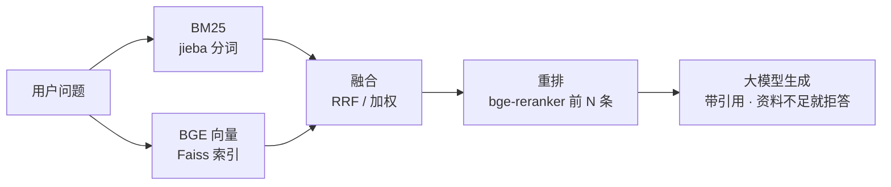

# 中文 RAG 检索问答：BM25 + BGE + Faiss + 重排

一个**可复现、可量化**的中文 RAG 检索系统：jieba + BM25 稀疏召回、BGE 稠密召回（Faiss 索引）、RRF / 加权融合、交叉编码器重排、带引用且会拒答的生成，以及一条命令跑完的消融评测。



## 实验结果（跑完后替换成你自己的数字）

数据：`mteb/CmedqaRetrieval`（中文医疗问答），test 划分 1000 条查询，约 10 万篇文档；指标 ×100，ms/q 为 GPU 批处理下每条查询耗时。

| 方法 | R@5 | R@10 | R@20 | R@100 | MRR@10 | nDCG@10 | ms/q |
| --- | --- | --- | --- | --- | --- | --- | --- |
| BM25 (jieba) | | | | | | | |
| Dense (bge-base-zh-v1.5 + Faiss) | | | | | | | |
| Hybrid · RRF | | | | | | | |
| Hybrid + Rerank (bge-reranker-v2-m3, top 50) | | | | | | | |
| + 微调后的 bge-base | | | | | | | |

`results/` 里每次评测都有一份 `.md`（表格 + 显著性检验 + 融合丢失 + 失败分类 + 完整配置）、`.json`、`_failures.jsonl`（全部失败案例，全文）和 `_runs.tsv.gz`（每条查询每个模式的前 100 名，事后分析不用重跑模型），可以直接复现。

失败案例按"问题出在哪一环"分成五类：召回失败（两路都没找到）、融合丢失（某一路排进了重排窗口，融合后掉出去）、截断失败（排在重排窗口 top_n 之外）、重排挤出（重排前在前 10，重排后被挤出）、排序失败（其余）。

## 快速开始

### 1. 安装（Python 3.10+，NVIDIA GPU）

```bash
conda create -n rag python=3.11 -y && conda activate rag
# 先装和你 CUDA 匹配的 PyTorch，以 https://pytorch.org/get-started/locally/ 生成的命令为准，例如：
pip install torch --index-url https://download.pytorch.org/whl/cu128
pip install -r requirements.txt
```

国内下载模型和数据集，先设置镜像：

```bash
export HF_ENDPOINT=https://hf-mirror.com           # Linux / macOS / Git Bash
$env:HF_ENDPOINT = "https://hf-mirror.com"         # Windows PowerShell
```

### 2. 五分钟跑通 demo

`data/demo` 是 30 段虚构的《云栖大学学生手册》和 18 个问题，只用来确认环境没问题（语料太小，指标没有参考意义）。

```bash
python scripts/build_index.py --config configs/demo.yaml
python scripts/evaluate.py   --config configs/demo.yaml
python scripts/ask.py        --config configs/demo.yaml -q "宿舍里能用电热毯吗"
```

### 3. 正式实验（默认读 configs/default.yaml）

配置和命令里的相对路径一律相对项目根目录，在哪个目录下运行脚本（包括 PyCharm）结果都一样。

```bash
python scripts/prepare_data.py --hf mteb/CmedqaRetrieval --out data/cmedqa   # 下载并划分 train/dev/test
python scripts/build_index.py                                               # BM25 + 向量 + Faiss
python scripts/evaluate.py --latency 100                                    # 消融表 + 失败分析 + P50/P95
python scripts/bench_faiss.py                                               # flat / HNSW / IVF / IVF-PQ 对比（默认用 dev）
```

### 4. 调参：只在 dev 上调，最后在 test 上报告一次

```bash
python scripts/evaluate.py --split dev --set reranker.top_n=20 --tag topn20
python scripts/evaluate.py --split dev --set retrieval.fusion=weighted --set "retrieval.weights={bm25: 0.2, dense: 0.8}"
python scripts/tune_fusion.py --split dev        # BM25/向量各跑一次，枚举融合方式、RRF k、两路权重，给出最优的 --set 参数
# 改了影响索引的参数（嵌入模型、max_seq_length、jieba 模式、词典、k1/b、Faiss 建索引参数），先用同样的 --set 跑 build_index.py
python scripts/build_index.py --only dense --set embedder.model=BAAI/bge-large-zh-v1.5
python scripts/evaluate.py --modes dense,dense_rerank --set embedder.model=BAAI/bge-large-zh-v1.5
```

两次评测之间的差距是不是真的（比如 bge-base vs bge-large），用各自保存的 run 文件做配对显著性检验：

```bash
python scripts/compare_runs.py --a results/<base 那次>_runs.tsv.gz:dense --b results/<large 那次>_runs.tsv.gz:dense
```

### 补标评测：修正标注不完整

CMedQA 的"正确答案"只是原帖下医生的回复，别处同样能回答的回答一律算错，重排会因此被低估。用大模型给各方法前 10 名里没被标注的结果打分（0/1/2），再按"原标注 ∪ 大模型判相关"重算指标，并抽样人工盲评算一致率：

```bash
python scripts/relabel.py judge --runs results/<某次评测>_runs.tsv.gz --dry-run          # 先看要打多少分
python scripts/relabel.py judge --runs results/<某次评测>_runs.tsv.gz --max-queries 50    # 小规模试跑
python scripts/relabel.py judge --runs results/<某次评测>_runs.tsv.gz                     # 全量（打过的自动跳过）
python scripts/relabel.py agree --csv results/relabel/<名字>_human.csv                   # 填完人工评分后算一致率
```

补标只用于评估，不用于调参；报告里原始指标、补标指标和人工一致率都要给出。

### 5. 生成回答

```bash
export LLM_API_KEY=你的key            # Linux / macOS；DeepSeek 或任意 OpenAI 兼容接口，在 configs 里改 base_url / model
$env:LLM_API_KEY = "你的key"          # Windows PowerShell
python scripts/ask.py
```

本地模型：`ollama pull qwen3:8b`，再加 `--set generation.base_url=http://localhost:11434/v1 --set generation.model=qwen3:8b`。

## 用你自己的文档

```bash
python scripts/prepare_data.py --docs-dir my_docs --out data/mydomain --chunk-size 400 --overlap 80
```

之后写 `queries.jsonl` 和 `qrels.tsv`（格式见 `rag/data.py` 开头）：让大模型给每个文本块出 1–3 个问题，再人工核对至少 200 条。然后生成固定的 train/dev/test 划分：

```bash
python scripts/prepare_data.py --make-splits data/mydomain --n-test 200 --n-dev 50
```

复制 `configs/default.yaml`，把 `data_dir` / `index_dir` 改成新目录即可。没有 `splits.json` 时评测会直接报错，不会悄悄把 test 查询混进调参。

## 目录结构

```
configs/            default.yaml（CmedQA）、demo.yaml
rag/
  data.py / prep.py 统一数据格式、下载公开数据集、切分自有文档、train/dev/test 划分
  config.py         YAML 配置 + 命令行 --set 覆盖（相对路径相对项目根目录，见 paths.py）
  text.py           jieba 分词、中文切块
  bm25.py           BM25 检索（bm25s）
  embedder.py       BGE 编码（sentence-transformers），查询指令、归一化
  dense.py          Faiss：flat / hnsw / ivf / ivfpq，索引指纹防止读到过期缓存
  indexing.py       建 / 读索引，核对建索引参数和当前配置是否一致
  fusion.py         RRF、加权融合
  reranker.py       交叉编码器重排
  pipeline.py       在线问答流程
  generator.py      带引用的提示词 + OpenAI 兼容接口
  metrics.py        Recall / MRR / nDCG（与 pytrec_eval 口径一致），逐条查询的指标
  evaluation.py     消融评测、失败分类、融合丢失、融合调参、显著性、延迟
  stats.py          配对随机化检验 + bootstrap 置信区间
  runs.py           逐条排序结果（_runs.tsv.gz）的读写
  judge.py          大模型补标：候选池、打分与缓存、合并标注、一致率
  advanced/         进阶部分（待实现）
scripts/            prepare_data / build_index / evaluate / tune_fusion / compare_runs / relabel / bench_faiss / ask / finetune_embedder
tests/              单测（用假模型，不需要 GPU）
```

## 进阶（待实现）

| 方向 | 文件 | 怎么证明有效 |
| --- | --- | --- |
| 检索层级化（父子分块） | `rag/advanced/hierarchical.py` | 自有长文档上 doc 级 Recall@5、答案完整性 |
| Reasoning（改写 / HyDE / 分解 / 充分性检查） | `rag/advanced/query_rewrite.py` | 难问题上的检索指标和答案正确率，多花的延迟 |
| 大小模型分工（路由） | `rag/advanced/router.py` | 同等正确率下的成本和延迟 |
| Embedding 领域微调 | `scripts/finetune_embedder.py` | test 上 nDCG@10：微调 base vs 原始 base / large |

`tests/test_advanced.py` 里有对应的单测，实现之前自动跳过，实现之后应该全部通过。

## 测试

```bash
python -m unittest discover -s tests -t . -v
```

单测用假模型（字符 bigram 哈希），不需要 GPU，也不用下载模型。

## 常见问题

- **下载模型/数据集卡住**：确认设置了 `HF_ENDPOINT`；也可以先 `hf download BAAI/bge-base-zh-v1.5 --local-dir models/bge-base-zh-v1.5`（旧版本命令是 `huggingface-cli download`），再把配置里的模型名改成本地路径。
- **显存不够**：调小 `embedder.batch_size` / `reranker.batch_size`，或换 `BAAI/bge-reranker-base`。
- **Windows**：`faiss-cpu` 有 Windows 安装包；中文 `.txt` 是 GBK 编码也能读。
- **评测报"找不到索引"或"参数不一致"**：换了嵌入模型、jieba 模式、词典、k1/b 或 max_seq_length 之后，要带同样的 `--set` 重新运行 `build_index.py`。不同嵌入模型的索引放在不同目录，互不覆盖；Faiss 索引参数变了会自动用已存的向量重建。
